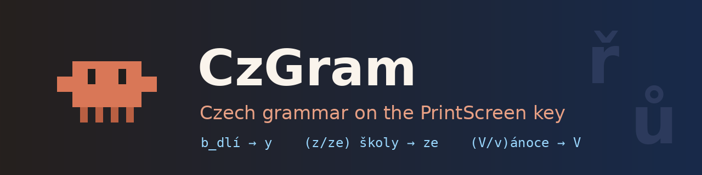

<p align="center">
  
</p>

<p align="center">
  
  
  
  
  
  
  
  
</p>

<p align="center">
  <b>Press PrintScreen while solving Czech grammar. CzGram finds the gap, names the rule, and an animated mascot explains it.</b>
</p>

---

CzGram is an AI-powered helper for Czech grammar exercises. Its offline rulebook is filled with rules and examples, and it
reads exercises from a screenshot (OCR with Tesseract), straight from the page's HTML, or from a word you highlight. You
pick the method in settings. It can also ask an AI for a specific answer: through your Claude account, an Anthropic API
key, or any OpenAI-compatible provider, including a self-hosted one.

## ✨ Features

| Feature | What it does |
| --- | --- |
| 📸 **Screenshot OCR** | Finds gaps like `b_dlí`, `Vidím ___ psa` and `(mě/mně)` anywhere on screen. |
| 🌐 **Page reading** | Reads the browser tab's HTML directly, with automatic fallback either way. |
| 🖱️ **Manual mode** | Highlight any word and press PrintScreen to get the rule behind it. |
| ⚡ **Quick mode** | Watches the page and answers each new question as it appears. It never clicks for you. |
| 💻 **Bulk mode** | A whole set of questions on one page? Double-tap Alt (or a key you choose): one request answers them all, and each answer appears as you answer the one before. |
| 📚 **Offline rules** | Listed words (vyjmenovaná slova), hard/soft consonants, s/z/vz, z/ze, s/se, capital letters and more. |
| 🤖 **AI answers** | Optional. Your Claude plan, an Anthropic key, or another provider, at about 960 input tokens per lookup. |
| 🔥 **Speed mode** | With Opus or Fable the bar turns blue and the mascot catches fire and runs. |
| 🔢 **Token tracking** | See what CzGram's Claude lookups have used today, this week and overall. |
| 🛡️ **Security reviewed** | Keys stay private, secret form fields are never read, and web pages can't stall it. [Details](#security) |

## 📝 What's new

| Version | Changes |
| --- | --- |
| **2.2.1~exp** (`experimental` branch only) | 2.2.0~exp on top of 2.1.3, with its launcher fix. |
| **2.2.0~exp** | [Check in the IJP](#ijp): answers follow the Internetová jazyková příručka, and the bar links the word to look up there. Off, when needed or always, in settings. |
| **2.1.3** (current release) | The `czgram` command always runs the installed copy. Started in a folder holding a `czgram` package or a `json.py`, it used to run that instead. Package CI now checks it. |
| **2.1.2** | The macOS badge at the top of this page shows "supported" on silver. |
| **2.1.1** | Bug fixes. A bulk-mode offer after a PrintScreen scan now ends after 45 seconds even when the browser can't be reached. Changing the bulk-mode key takes effect without restarting quick mode. On Windows, the bulk-mode button no longer stops the bar from closing cleanly. The Debian, Ubuntu and Arch packages are now built, installed and tested automatically, like the others. |
| **2.1.0** | The bulk-mode offer sits at the bottom of the bar, with a white **Double Alt to Confirm** button. The key can be Alt, Ctrl or Shift (Settings → Quick mode). Browser extension 2.1.0: reload it after updating. |
| **2.0.0** | [Bulk mode](#-modes): a whole page of questions in one request. Browser extension 2.0.0. Packages for Fedora, RHEL and openSUSE on the `rpm-based` branch, and an experimental Windows port. |

## 🐧 Supported systems

| System | Status | How to install |
| --- | --- | --- |
|  **Debian**, **Ubuntu**, **Kali**, Linux Mint, Pop!_OS | ✅ Native, `.deb` package (`main` branch) | [Debian-based](#install-debian) |
|  **Arch Linux**, **Manjaro**, **EndeavourOS**, Garuda | ✅ Supported, `PKGBUILD` | [Arch-based](#install-arch) |
|  **macOS** 11 or later (Apple silicon and Intel) | ✅ Supported, `macos` branch | [macOS](#install-macos) |
|  **RHEL** 9 and 10, Rocky, AlmaLinux, **Fedora**, **openSUSE** Tumbleweed and Leap 16 | ✅ Supported, `.rpm` package (`rpm-based` branch); openSUSE and AlmaLinux may need additions | [RHEL and RPM based](https://github.com/unforged1/CzGram/tree/rpm-based#install-rpm) |
| Other Linux | ⚠️ No package yet | Not tested |
|  **Windows** 10 (1809 or later) and 11 | 🧪 Experimental, `windows` branch; may be dropped later | [Windows](https://github.com/unforged1/CzGram/tree/windows#install-windows) |

> [!WARNING]
> **Windows support is experimental and isn't guaranteed to stay.** The port on the `windows` branch is tested
> automatically on a Windows machine with every change, but it hasn't been tried on everyday PCs, and it may be
> dropped in a later release if it can't be kept working well. Use it to try CzGram on Windows, not as something to
> rely on for the long run. Linux and macOS are the supported systems.

Tested on Kali Linux with GNOME, and in an Arch Linux container (build, install, offline OCR and all tests).

| Desktop | PrintScreen key | Screenshots |
| --- | --- | --- |
| GNOME, XFCE | ✅ Set up for you when you save settings | ✅ |
| KDE Plasma, Hyprland, Sway, Cinnamon, others | 🛠️ Add a shortcut that runs `czgram --trigger` | ✅ X11 directly, Wayland through `xdg-desktop-portal` |
| macOS | ✅ **⌃⌥G** (Control-Option-G), or F13 on extended keyboards | ✅ After you allow Screen Recording |

## 📦 Install

<a id="install-debian"></a>

###  Debian, Ubuntu, Kali and similar

```bash
git clone https://github.com/unforged1/CzGram.git
```

```bash
cd CzGram && sh packaging/build_deb.sh
```

```bash
sudo apt install ./dist/czgram_2.2.1~exp_all.deb
```

Building needs `dpkg-deb` and `python3-pil`, which most Debian-based systems already have.

<a id="install-arch"></a>

###  Arch Linux, Manjaro, EndeavourOS and similar

The Arch package lives on the `arch-based` branch. You need `git` and `base-devel` (`sudo pacman -S --needed git base-devel`).

```bash
git clone -b arch-based https://github.com/unforged1/CzGram.git
```

```bash
cd CzGram/packaging/arch && makepkg -si
```

`makepkg -si` builds the package, installs every dependency from the official repositories (including
`tesseract-data-ces` for Czech) and installs CzGram with pacman. Optional extras:

| Package | For |
| --- | --- |
| `python-anthropic` | AI answers through an Anthropic API key |
| `xdg-desktop-portal` + your desktop's backend | Screenshots on Wayland |
| `xdg-utils` | Opening links from the settings window |

To update later, run `git pull` in the `CzGram` folder, then `makepkg -si` again in `packaging/arch`.

<a id="install-macos"></a>

###  macOS

The macOS port lives on the `macos` branch. You need [Homebrew](https://brew.sh); the script installs Python, Tk,
Pillow and Tesseract with it, adds the Czech OCR data, and creates `~/Applications/CzGram.app` and a `czgram` command.

```bash
git clone -b macos https://github.com/unforged1/CzGram.git
```

```bash
cd CzGram && bash packaging/macos/install.sh
```

Macs have no PrintScreen key, so CzGram uses **⌃⌥G** (Control-Option-G), and F13 where your keyboard has one.
macOS asks for two permissions under **System Settings → Privacy & Security**:

| Permission | Needed for |
| --- | --- |
| Screen Recording | Reading the screen. Without it, screenshots show only the desktop background. |
| Accessibility | Selected word (manual) mode only: CzGram copies your selection with ⌘C. |

To remove it, run `bash packaging/macos/uninstall.sh`.

### 🚀 First start

Open **CzGram** from the applications menu (or run `czgram`), choose your settings and press **Save**. Then open a Czech
exercise and press **PrintScreen**. The bar appears at the top of the screen; press ✕ to close it.

> [!IMPORTANT]
> On GNOME and XFCE, saving replaces the desktop's PrintScreen shortcut. To get it back, untick the option in settings
> or run the command below. **Run it before uninstalling**, because the shortcut is a per-user setting that package
> removal can't reach.
>
> ```bash
> czgram --restore-shortcut
> ```

Uninstall with `sudo apt remove czgram` (Debian-based), `sudo pacman -R czgram` (Arch-based) or
`bash packaging/macos/uninstall.sh` (macOS).

## ⚙️ Settings

| Option | What it does |
| --- | --- |
| Screenshot (OCR) | Reads the screen with Tesseract. |
| Switch to page code automatically | Reads the page's HTML if the screenshot can't be read or has no exercise in it. |
| Page code (HTML) | Reads the active browser tab directly. Falls back to the screenshot if no browser answers. |
| Selected word (manual) | Explains the word you highlighted. |
| Quick mode | Reads the page continuously and answers each new question. |
| Speed mode | Blue look and instant text with Opus or Fable. |
| Minimize RAM usage | Closes the bar when dismissed and skips 2x OCR upscaling. |
| Claude mascot | Animated, typed-out explanation. Click it to skip the animation. |
| Language | Explanations in English or Czech. |
| Bulk mode shortcut | The key to double-tap to confirm bulk mode: Alt (default), Ctrl or Shift. |
| Check in the IJP | Off, When needed (default) or Always: answers follow the Internetová jazyková příručka, and the bar links the word to look up there. See [below](#ijp). |
| AI answers | Optional, off by default. Gives a specific answer in place of the general rule. |

## 🧭 Modes

<details>
<summary><b>🖱️ Manual mode</b>: highlight a word, press PrintScreen</summary>

Choose **Selected word (manual)** in settings, highlight a word with the mouse in any app, and press PrintScreen. CzGram
explains that word, or the whole line if you highlight an exercise line with a gap. No screenshot is taken. In the browser,
with the connector active, it also reads the sentence around the word and gives it to the AI for context. Manual
detection turns quick mode off. Like all AI answers, the highlighted text and sentence go to the service you chose.
</details>

<details open>
<summary><b>💻 Bulk mode</b> (new in 2.0): a whole page of questions in one request</summary>

When CzGram reads a tab in page-code mode, it reads the whole page, including what's scrolled out of view. If the
page holds a set of two or more questions, such as a worksheet or a form, the bar offers bulk mode at the bottom of
the panel, next to a white, rounded **Double Alt to Confirm** button:

> ⚡ 6 questions on this page: answer them all at once (bulk mode). &nbsp; `Double Alt to Confirm`

Double-tap **Alt** in the browser to accept. To use another key, choose **Alt**, **Ctrl** or **Shift** under
**Settings → Quick mode** (or set `"bulk_key"` to `"Alt"`, `"Control"` or `"Shift"` in `config.json`); the button
then names that key. CzGram sends every question in **one request** and shows the answers one
at a time, starting with the first. **Answer it on the page and the next answer appears by itself**, with no further
requests. ◀ ▶ let you look ahead or back without changing your place. The mascot sits at its laptop and types flat
out while bulk mode is on.

- It works in quick mode, and after a PrintScreen scan in page-code mode (the offer then stays open for 45 seconds).
- It applies to that set only. It ends after the last question, or when you leave the page, and quick mode carries
  on without re-answering what bulk mode covered.
- Answers count when you click an answer (a button, option, radio or checkbox) or finish typing in a gap (Enter or
  leaving the box). Clicking blank space, scrolling or pressing other keys doesn't move it on.
- With AI answers off, bulk mode shows the offline rules' suggestions instead.
- A single request is cheaper than one per question: a 6-question test sheet took 1.7k tokens in total, against
  about 1k for each separate lookup.
- Like the rest of CzGram, it never clicks or types on the page.

After installing 2.1, reload the browser extension (version 2.1.0), which lets the confirm key be changed.
</details>

<details>
<summary><b>⚡ Quick mode</b>: answers each new question by itself</summary>

Tick **Quick mode** in settings, then press PrintScreen to turn it on, and again (or ✕) to turn it off. While
it's on, the mascot looks busy, the bar reads the active tab's HTML about twice a second, and each new question
gets an answer on its own: from your AI service if AI answers are on, otherwise from the offline rules.

It only reads the page. It never clicks or types, so you choose every answer. It recognises the question and answer
buttons on the Umíme sites, and an already answered question costs no further requests. Elsewhere it uses the general
page reader. Offline suggestions can be wrong on harder levels, so use AI answers where a mistake costs you progress.

Answers with long vowels (`í`, `ý`) are matched exactly, and any extra word or sentence beside the question is shown in
the bar and given to the AI, because it can change which rule applies. The offline rules can't weigh that kind of note or
pick a vowel length when both are offered, so they tell you to check. AI answers handle these cases better.

After installing a new version, reload the extension once: press Reload on it in `chrome://extensions`, or load it again
in Firefox.
</details>

<details>
<summary><b>🔥 Speed mode</b>: blue bar, running mascot</summary>

Tick **Speed mode** in settings. When the selected model is Opus or Fable, on any connection, the bar turns blue, the mascot
catches blue fire and runs, and answers appear at once instead of being typed out. With the `default` Claude model, the look
switches on once Claude reports which model it's using. It changes the look and the text speed, not how fast the model answers.
</details>

## 🌐 Page code: the browser connector

Reading HTML needs a small extension, added once. The app's settings can open its folder
(`/usr/share/czgram/extension`). Save settings first: that registers the connector with your browsers.

- **Chromium, Chrome, Brave:** `chrome://extensions` → Developer mode → Load unpacked → the `chromium` folder.
- **Firefox:** `about:debugging` → This Firefox → Load Temporary Add-on → `firefox/manifest.json`.
  Firefox removes temporary add-ons when it restarts; a permanent install requires signing the add-on.

The extension acts only when CzGram asks and sends what it reads only to the local app. It reads the active tab's visible
content, or the whole page, scrolled-out parts included, when CzGram looks for a set of questions for bulk mode. Once
CzGram has read a tab, the extension also counts double taps of the bulk-mode key (Alt unless you change it) and the answers you give there, so bulk mode can
follow along; it counts them and nothing else, never what you type or click. It does need permission to read all sites
to be able to do this. It never reads password, card, one-time-code or hidden fields, and it sends at most 1 MB per page.
See [Security](#security).

## 🤖 AI answers: three ways to connect

Pick the service and its model under **AI answers** in settings. Each service remembers its own model.

The AI works out what each exercise tests by itself. CzGram adds a rule only when the gap's own text calls for it:
the listed-words row for the letter before an i/y gap, the s/z rules for an s/z choice, the capitals rules for a
V/v choice. This keeps a lookup to about 960 input tokens through Claude Code, down from about 1,840 in 1.7.

| Connection | Cost | Setup |
| --- | --- | --- |
| **Your Claude plan** (through Claude Code) | Counts toward your plan's limits | Press **Sign in** in settings |
| **Anthropic API key** | Billed per use | `python3-anthropic` (Debian) or `python-anthropic` (Arch) |
| **Another provider** (OpenAI-compatible) | Depends on the provider | Enter its address and key, press **Load models** |

<details>
<summary>More about each connection</summary>

**Your Claude plan, through Claude Code.** No API key or per-lookup charge; lookups count toward your plan's
usage limits. CzGram uses `claude` from your PATH, or else the copy inside the Claude desktop app. Press
**Sign in** in settings once; this signs Claude Code in separately from the desktop app. **Load models** asks
Claude Code what your plan offers, without using any quota. Lookups run at low effort. Each one starts
Claude Code, so it's slower and briefly uses far more memory than the offline rules. It runs with no tools, MCP
servers or settings, in an empty folder, so text on your screen can't make it do anything except answer.

**An Anthropic API key.** Billed per use from console.anthropic.com. If the key field is empty, the SDK's usual
credentials such as `ANTHROPIC_API_KEY` are used instead.

**Another provider.** Anything with an OpenAI-compatible API (`/chat/completions`, ideally `/models`), such as
[FreeLLMAPI](https://github.com/tashfeenahmed/freellmapi), Groq, OpenRouter or a local server. Enter its address,
for example `http://localhost:3001/v1` for FreeLLMAPI, and its key (FreeLLMAPI's unified key comes from its
dashboard; not the upstream provider keys). Then press **Load models**. Recognised text goes to that provider
under its own privacy terms. A free-tier proxy may pass it on to several upstream companies, so don't use one for
anything private. An `http://` address that isn't on this computer isn't encrypted, and settings warns about it.

Keys are stored in `~/.config/czgram/config.json`, readable only by you.
</details>

<a id="ijp"></a>

### 📖 Checking in the Internetová jazyková příručka

The [Internetová jazyková příručka](https://prirucka.ujc.cas.cz) (IJP) of the Czech Language Institute (ÚJČ AV ČR)
is the reference for Czech spelling and grammar. Under **Check in the IJP** in settings:

| Setting | What happens |
| --- | --- |
| **When needed** (default) | AI answers follow the IJP's codification. When the offline rules can't decide an item, or the AI isn't sure about a word (its spelling, vowel length, capital letter or an accepted variant), the bar shows **📖 Check in IJP: *word*** under the answer. |
| **Always** | The same, and every answer gets the link. In bulk mode, every answer in the set. |
| **Off** | No IJP instructions and no link. |

Click the link to open that word's IJP page in your browser. Without AI answers, the bar links a highlighted word, or
a gap's word with the offline rules' letter filled in, as it's written (the AI names the dictionary form).

CzGram doesn't read the IJP itself, and the AI can't open it either: the site doesn't allow programs to look words
up (its `robots.txt`), and its legal notice allows copying its content only with ÚJČ's consent. So the AI is told to
follow the IJP and never to claim it checked it, and the check itself is the page you open.

### 🔢 Tracking Claude tokens

Settings shows the tokens CzGram's Claude lookups have used today, over 7 days and overall. The bar shows each answer's count,
and `czgram --usage` gives a breakdown by model. The numbers are the ones Claude reports, kept in
`~/.local/state/czgram/usage.json`, which holds only numbers. Other providers aren't counted. It covers CzGram only, so it
won't match your plan's overall usage, and it can't show how much of your plan's limit remains. Thinking tokens are part of output.

## 📚 Grammar topics

<details>
<summary><b>Prefixes and prepositions</b> (s/z/vz, z/ze, s/se)</summary>

Offline, CzGram suggests a prefix only for common words where one prefix is standard (smíchat, zmrznout, vzkvétat).
Where the meaning decides, as with sletět (fly down) and vzlétnout (fly up), it gives the rule instead. For the
prepositions s and z it reads the case from the next word's ending when the ending is clear (s kamarádem, z domů),
and it picks se/ze before s, š, z, ž and in set phrases like se mnou. OCR often reads these choices wrongly (`slz`,
`zíze`, `(2/ze)`), and CzGram repairs them, leaving real words such as *slz* (tears) alone. AI answers get a short
version of these rules when the gap is an s/z choice.
</details>

<details>
<summary><b>Capital letters</b> (velká písmena), new in 1.8</summary>

CzGram recognises capital-letter exercises: choices like `(V/v)ltava` or `V/vánoce`, buttons with the two letters
or with "velké / malé", and single highlighted words in manual mode. Offline it decides the common cases: the start
of a sentence, days and months, languages, inhabitants and nationalities, holidays, well-known places, possessive
adjectives from names (Karlův most) and adjectives from places (pražský). Where the meaning decides, as with
Země (the planet) and země (soil), it says so instead of guessing. OCR often misreads these choices (`(Č/čJech`,
`(Kik)arlův`, `Vývánoce`) and CzGram repairs them. AI answers get a short version of these rules when the gap is a
capital-letter choice.
</details>

## 🔒 Privacy

Offline by default: screenshots stay in memory and aren't saved. (The Wayland portal writes a file,
which is deleted immediately.) If you turn on AI answers, the recognised text of each item you view is sent
to the service you chose. Only that text is sent, never the image. CzGram doesn't contact the Internetová jazyková
příručka; when you click a **Check in IJP** link, your browser opens that word's page there.

<a id="security"></a>

## 🛡️ Security

CzGram reads your screen and, if you add the connector, your browser tab, so it's built to keep that
data on your computer and out of reach of web pages.

| Area | How it's protected |
| --- | --- |
| 🔑 API keys | Stored in `~/.config/czgram/config.json`, readable only by you, masked in settings and never logged. |
| 🤖 Claude Code | Runs with no tools, no MCP servers, no settings and no API key from your environment, in an empty folder. Text on screen can only change the answer, never make it act. |
| 📖 IJP links | Only a word or short phrase of letters becomes a link, always to prirucka.ujc.cas.cz, so a page can't plant a link to anywhere else. It opens only when you click it. |
| 🌐 Other AI providers | Redirects are refused, so your key is never resent to another address. Unencrypted `http://` addresses off your computer get a warning. |
| 🧩 Browser connector | Reads the active tab only when CzGram asks. It skips password, card, one-time-code and hidden fields, and sends at most 20 frames and 1 MB per page. For bulk mode it counts double taps of the chosen key and answers, without recording which keys, text or choices. |
| 🔌 Local sockets | Private to your user from the moment they're created, inside a folder only you can open. Oversized messages are refused. |
| ⏱️ Page text | Long or crafted lines can't stall the analyzer: patterns run in linear time and lines are capped at 2,000 characters. |
| 📦 Installers | The macOS installer downloads the Czech OCR data from a pinned commit and checks its hash before using it. |

<details>
<summary><b>Security review, November 2026</b>: what was fixed</summary>

A full review of the app, the browser extension, the installers and the repository history. No keys, tokens or
personal settings were ever committed. The fixes are on every branch:

| Severity | Issue | Fix |
| --- | --- | --- |
| 🔴 High | The page snapshot included the value of every input, so password and card fields could reach any program running as you that asked the connector. | Secret-looking fields are skipped (extension 1.4.0). |
| 🟠 Medium | A page with one very long line could make the analyzer work for over 20 seconds, twice a second in quick mode. | The choice pattern is anchored to word starts; lines are capped. |
| 🟠 Medium | A page with hundreds of frames could send hundreds of megabytes to the app. | 20 frames and 1 MB per page; both ends refuse messages over 8 MB. |
| 🟡 Low | Sockets were made private just after creation, not at creation. | Created private with a restrictive umask. |
| 🟡 Low | A model name starting with `-` would be read as a Claude Code option. | Model names are validated. |
| 🟡 Low | A path with a quote or space could break the GNOME, XFCE or autostart shortcut. | Paths are quoted properly. |
| 🟡 Low | Cleaning up a Wayland screenshot trusted the path it was given. | Only a regular file you own is deleted, never a link. |
| 🟡 Low | The macOS installer took the OCR data from a moving branch. | Pinned to a commit and hash-checked. |

**After updating, reload the browser extension** (Reload in `chrome://extensions`, or load it again in Firefox),
because the password-field fix lives in the extension.
</details>

Found a problem? Open an issue on GitHub. For anything sensitive, contact the maintainer through GitHub first
instead of posting details publicly.

## ⚠️ Limits

- Offline answers are rule-based hints. A suggested letter comes only from a spelling rule that
  decides it; endings, cases and agreement get the rule but no answer. Turn on AI answers for specifics.
- The offline listed-words check covers common roots and can miss rare relatives.
- OCR reads the whole screen on Wayland, so other Czech text on screen can show up as items.
- The bar is an X11 window, shown through XWayland on Wayland.
- Bulk mode follows your answers by counting clicks, so it can get out of step if a page has extra buttons inside
  the set, or if a gap isn't recognised. ◀ ▶ get you back to the right answer. It's tested in Chromium; in Firefox
  the double tap should work too, but hasn't been tested yet.
- On macOS, the bar and settings window show a Python icon in the Dock while open, and manual mode replaces
  a non-text clipboard (such as a copied image) when it copies your selection.

## 🛠️ Development

```bash
python3 -m unittest discover tests
```

```bash
sh packaging/build_deb.sh
```

On the `arch-based` branch, the Arch package builds with the command below, and both packages install the same files
through `packaging/stage.sh`.

```bash
cd packaging/arch && makepkg -f
```

## 📄 License

MIT, © 2026 unforged1. See [LICENSE](LICENSE).
